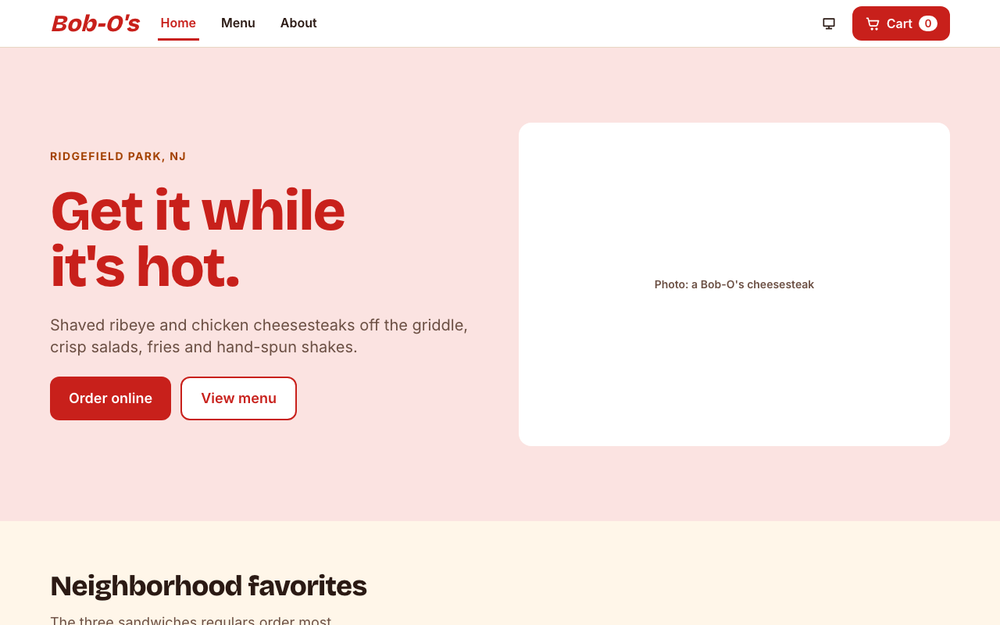
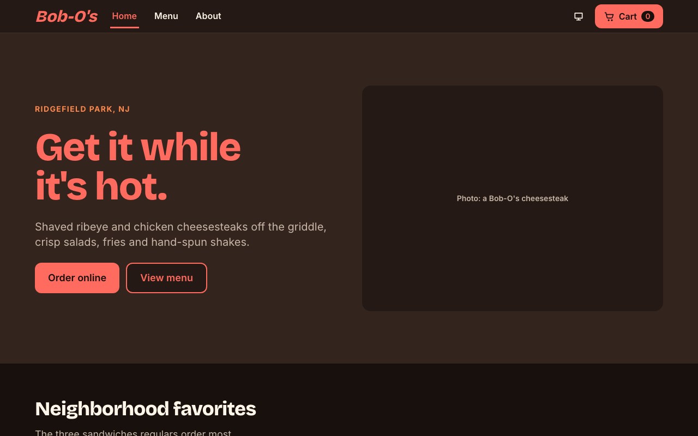
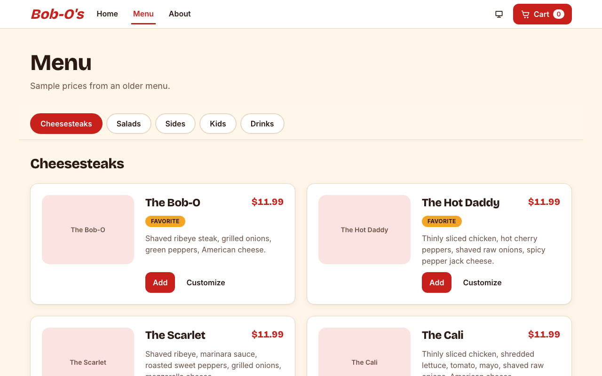
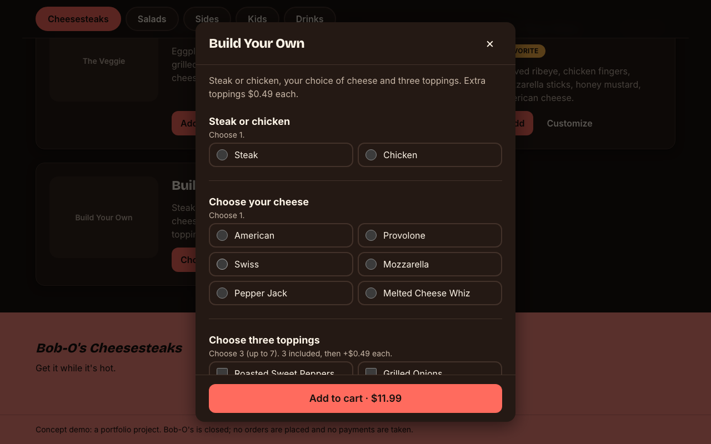
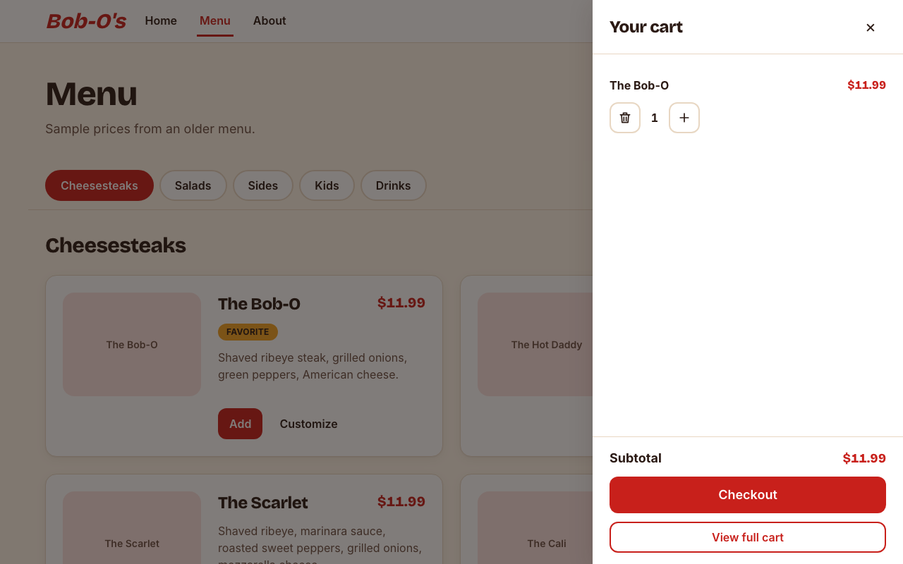

# Bob-O's Cheesesteaks: concept demo site

A portfolio/concept website for **Bob-O's Cheesesteaks** (252 Main Street, Ridgefield Park, NJ).
The restaurant is closed and its brand belongs to it, so this is a demo: **no real orders are placed and
no payments are taken**. Menu prices come from an older printed menu and are labeled as sample data.

| Light | Dark |
| --- | --- |
|  |  |
|  |  |
|  | |

## Features

- **Menu** with sticky category tabs (one category at a time), item cards, and an options dialog
  (Build Your Own: steak/chicken, cheese, three toppings; extras priced automatically)
- **Cart drawer** and full **cart page**: quantity steppers, Delivery/Pickup, 15/20/25%/custom tip,
  totals in integer cents
- **Dummy Stripe checkout**: `POST /api/checkout` re-validates and re-prices on the server, then
  returns a mock success URL
- **Light / dark / system theme** from one set of semantic color tokens, with no flash on load
- Home (hero, favorites, map + hours, contact form), About, order success/cancel, 404 and error pages
- WCAG 2.1 AA in both themes, keyboard friendly, Lighthouse 94+ performance and 100 accessibility

## Stack

Next.js 16 (App Router, Cache Components) · React 19 · TypeScript (strict) · Tailwind CSS v4 ·
zod · next-themes · Vitest + Testing Library · Playwright + axe-core · Lighthouse CI

## Getting started

```bash
cd bobos-site
nvm use            # Node 24 LTS (.nvmrc)
npm install
npm run dev        # http://localhost:3000
```

| Command | What it does |
| --- | --- |
| `npm run check` | Prettier check, ESLint, typecheck, unit/component/API tests |
| `npm run test:e2e` | Playwright flows (desktop + mobile, light + dark) |
| `npm run test:a11y` | axe-core WCAG 2.1 AA on every route |
| `npm run test:visual` | Screenshot comparisons (baselines are macOS-specific) |
| `npm run build && npm run lhci` | Lighthouse CI against the production build |

## Project layout

```
bobos-site/src/
  app/                 routes only (thin pages) + API route handlers
  components/ui/       generic building blocks (no restaurant knowledge)
  components/layout/   header, footer, container, section, nav link, theme toggle
  components/features/ home, menu, cart pieces
  data/                menu, hours, site info, page copy
  lib/                 pure, tested helpers (money, cart, validation, options)
  providers/ hooks/ constants/ types/ styles/
```

The full spec lives in [bobos-website-plan.md](bobos-website-plan.md), and working conventions in [CLAUDE.md](CLAUDE.md).
